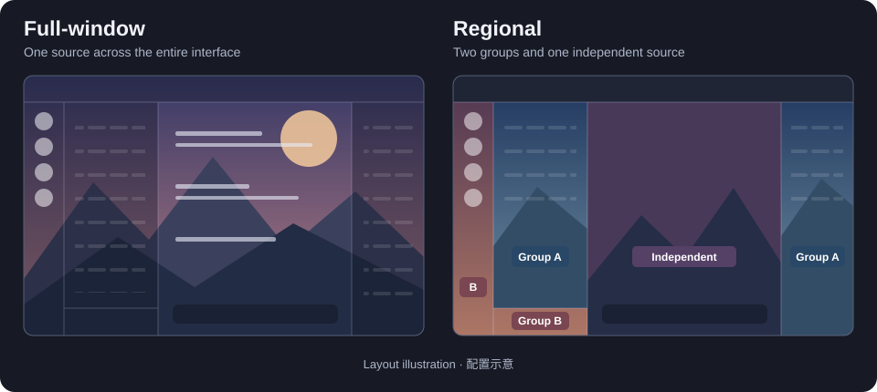

# Regional backgrounds / 分區背景

[English](#english) · [繁體中文](#繁體中文) · [README](README.md)

## English

### Display modes

**Full-window:** One source covers the entire window. Regional sources are paused while their configuration is retained.

**Regional:** Each of the five regions can use Shared, Native color, Independent, or one of Groups A–E. The common wallpaper is not drawn underneath other regions.

### Synchronization groups

1. Select Regional mode (分區模式) in the settings.
2. Expand each desired region and assign the same group under Background mode (背景模式), for example Group A.
3. Expand Synchronization group settings (同步群組設定（A～E）), open Group A, and select a folder or apply a directory path.
4. Adjust the group's rotation, fade, scaling, and position. Repeat for other groups as needed.

| Region | Example assignment |
| --- | --- |
| Server list | Group B |
| Channel / DM list | Group A |
| Chat area | Independent |
| Member list | Group A |
| User controls | Group B |

Group A and Group B rotate independently; the chat area's source has its own timer. A group uses the smallest rectangle enclosing its visible members as a shared canvas. Each member shows the corresponding cropped portion, preserving gaps between non-adjacent members.

### Appearance and source behavior

- Shared backgrounds use full-window coordinates. Groups use their own shared canvas.
- Shared and group regions can override dimming and blur only. Scaling and position belong to the source. Use Independent mode for region-specific framing.
- A group needs at least one assigned region before its source can be configured. Removing the last member stops playback and releases active image resources while preserving settings.
- Changing the global display mode retains the settings and temporarily suspended file lists within the current plugin session. Resumed playback may start from a different image.
- Native folder selection retains the folder name, not access permission, after a restart. Saved paths can be loaded automatically if the option is enabled.
- Use Region detection (區域辨識診斷) to inspect which areas of the interface are currently visible and recognized.

## 繁體中文

### 顯示模式

**全視窗模式：** 以單一背景來源覆蓋整個視窗，其他分區來源暫停輪播，原有設定仍會保留。

**分區模式：** 五個區域皆可選擇共用背景、原生色、獨立背景或 A～E 同步群組。共用圖片不會作為其他區域的底圖。

### 同步群組設定

1. 開啟背景設定，將全域顯示模式設為「分區模式」。
2. 展開需要同步的各個區域，在「背景模式」中選擇相同群組，例如「同步群組 A」。
3. 展開「同步群組設定（A～E）」中的群組 A，選取資料夾或套用路徑。
4. 設定群組的輪播、轉場、縮放與位置。其他群組依相同方式設定。

| 區域 | 配置範例 |
| --- | --- |
| 伺服器列表 | 群組 B |
| 頻道／私訊列表 | 群組 A |
| 中央聊天區 | 獨立背景 |
| 成員列表 | 群組 A |
| 使用者控制列 | 群組 B |

群組 A 與群組 B 各自輪播，中央聊天區另有獨立計時器。同群組以所有可見成員的最小外接矩形作為共同畫布，各區顯示對應裁切範圍；即使區域不相鄰，也會保留實際間距。

### 外觀設定與來源行為

- 共用背景使用全視窗座標，同步群組使用群組共同畫布。
- 共用及群組模式的區域覆寫僅限暗化與模糊。縮放與位置由來源統一控制；如需單獨取景，請使用獨立背景。
- 群組至少須有一個區域加入，才能設定圖片來源。最後一個區域退出後會停止輪播並釋放圖片資源，群組設定仍保留。
- 切換全域顯示模式會保留設定及本次工作階段中暫停來源的圖片清單；恢復時可能從不同圖片開始輪播。
- 原生選取方式僅保存資料夾名稱，重新啟動後需再次選取。路徑模式可透過自動載入選項在啟動時讀取。
- 可使用「區域辨識診斷」檢視目前可見且已辨識的介面區域。

[返回繁體中文 README](README.zh-TW.md)
