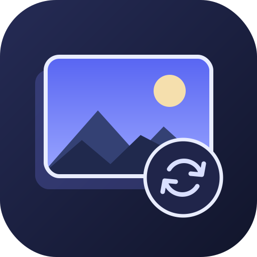
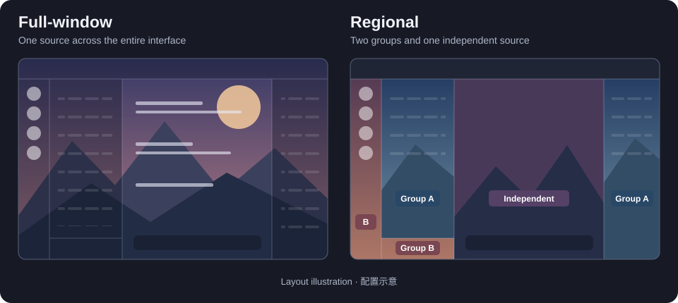

<p align="center">
  
</p>

<h1 align="center">BackgroundManager</h1>

<p align="center">A local wallpaper slideshow and regional background manager for BetterDiscord.</p>

<p align="center">
  
  
</p>

<p align="center"><a href="README.md">English</a> · <a href="README.zh-TW.md">繁體中文</a></p>

## Overview

BackgroundManager customizes the Discord desktop client with images from local folders. Use a single wallpaper across the entire window, or assign separate backgrounds to different parts of the interface. Images can rotate automatically without importing them into an image database.



*Layout illustration: full-window wallpaper and an example regional configuration. This is a schematic, not a Discord screenshot.*

## Features

- Full-window and regional display modes.
- Five configurable regions: server list, channel/direct message list, chat area, member list, and user controls.
- Shared backgrounds, independent slideshows, native-color masks, and five synchronization groups (A–E).
- Sequential or random rotation, adjustable intervals, crossfades, and manual switching.
- Brightness (dimming), blur, scaling, and horizontal/vertical positioning.
- Native folder selection or saved directory paths, with optional automatic loading and periodic rescanning in path mode.
- Quick access to settings from the Discord toolbar.

## Installation

1. Install [BetterDiscord](https://betterdiscord.app/) for the Discord desktop client.
2. Download [BackgroundManager.plugin.js](https://raw.githubusercontent.com/xyazqr/BackgroundManager/main/BackgroundManager.plugin.js). If you are viewing a development branch, download the plugin from that branch's file listing instead.
3. Open Discord **User Settings → BetterDiscord → Plugins → Open Plugins Folder**.
4. Move `BackgroundManager.plugin.js` into the folder and enable it in the plugin list.
5. Open its settings using the gear icon or the image button near the upper-right corner of Discord.

On Windows, the plugin folder is normally `%appdata%\BetterDiscord\plugins`. No npm installation, separate theme, or pre-existing configuration is required. Remove or disable any other plugin with the same name before enabling this one.

## Quick start

1. Under **全域顯示模式** (Display mode), choose **全視窗模式** (Full-window mode).
2. Expand **全視窗背景設定** (Full-window background settings).
3. Click **原生選取資料夾** (Native folder picker) and select a folder containing images.
4. Adjust dimming, blur, scaling, and the slideshow interval to suit your interface.
5. To configure different backgrounds, switch to **分區模式** (Regional mode) and assign a mode to each region.

The settings interface currently uses Traditional Chinese labels.

### Regional backgrounds

| Mode | Behavior |
| --- | --- |
| Shared | Uses the common wallpaper in continuous full-window coordinates, only in regions assigned to it. |
| Native color | Covers the region with its detected base color; not a complete restoration of the native theme. |
| Independent | Uses a separate image folder, slideshow, and appearance settings. |
| Synchronization group A–E | Shares one source, slideshow, and canvas among all visible regions in that group. |

For example, assign the channel and member lists to Group A, the server list and user controls to Group B, and the chat area to Independent. Configure the folders under the corresponding group or region settings. For shared and group backgrounds, local overrides affect only dimming and blur; scaling and positioning are controlled by the source.

See [Regional backgrounds and synchronization groups](GROUPS.md#english) for additional examples.

### Image sources

| | Native folder picker | Saved directory path |
| --- | --- | --- |
| Setup | Choose a local folder | Enter a path and click Apply path |
| After restart | Select the folder again | Saved path can load automatically if enabled |
| Folder changes | Select again | Rescans every 60 seconds during normal playback |
| Best for | First-time setup | Persistent wallpaper folders |

Both modes read local images. Enable recursive scanning before selecting or reapplying a folder if you want to include subfolders.

## Configuration

| Setting | Default | Range / options |
| --- | --- | --- |
| Display mode | Regional | Full-window / Regional |
| Regional assignment | Shared | Shared / Native / Independent / A–E |
| Include subfolders | Off | On / Off |
| Random rotation | On | On / Off |
| Automatic path loading | Off | On / Off |
| Slideshow interval | 10 min | 1–1,440 min |
| Crossfade | 1,000 ms | 0–5,000 ms |
| Dimming | 50% | 0–95% |
| Blur | 0 px | 0–20 px |
| Scaling | Cover | Cover / Contain / Stretch / Original size |
| Horizontal / vertical position | 50% / 50% | 0–100% |

Supported extensions: PNG, JPG, JPEG, WEBP, GIF, BMP, AVIF, and JFIF. Actual decoding depends on the Discord client's Chromium version. Each image is limited to 12 MiB and 24 megapixels. Path scanning is limited to 3,000 entries, 100 directories, and eight levels of subdirectories.

## Troubleshooting

- **No wallpaper:** select a small PNG or JPEG using the native folder picker and check the source status.
- **Path cannot be read:** check the folder path and permissions, or switch to the native picker.
- **A region is missing or covered:** use **區域辨識診斷** (Region detection) in regional settings and check whether another theme overrides the background. Hidden regions are not drawn.
- **Slideshow stops:** if an image cannot be decoded, automatic rotation pauses. Use **下一張** (Next image) to continue or remove the problematic image.
- **Discord fails to start:** remove the plugin from the BetterDiscord plugins folder and restart Discord.

Discord interface updates and third-party themes can affect CSS-based region detection. Large folders and animated images may also increase resource usage.

## Development

Node.js 22 or later is required for the development checks. The plugin has no npm dependencies.

```sh
git clone https://github.com/xyazqr/BackgroundManager.git
cd BackgroundManager
npm test
```

Optional browser integration scripts use Python and Playwright:

```sh
python -m pip install playwright
python -m playwright install chromium
python tests/browser_smoke.py
python tests/browser_groups.py
```

Set `CHROMIUM_PATH` if you need to use a specific Chromium executable.

## Resources

- [Traditional Chinese README](README.zh-TW.md)
- [Regional background guide](GROUPS.md#english)
- [Changelog](CHANGELOG.md)
- [Report an issue](https://github.com/xyazqr/BackgroundManager/issues)
- [BetterDiscord documentation](https://docs.betterdiscord.app/)

## Credits and license

BackgroundManager is an independent rewrite, not an official version of [Narukami's BackgroundManager](https://github.com/Naru-kami/BackgroundManager-plugin). It is not affiliated with Discord or BetterDiscord. The project icon is original artwork.

No open-source license has been specified for this repository.
