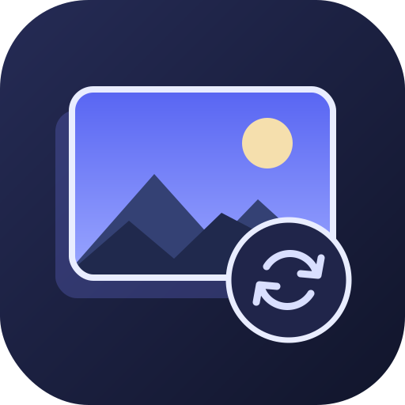
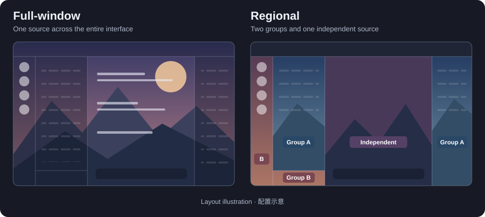

<p align="center">
  
</p>

<h1 align="center">BackgroundManager</h1>

<p align="center">適用於 BetterDiscord 的本機背景輪播與分區背景管理插件。</p>

<p align="center">
  
  
</p>

<p align="center"><a href="README.md">English</a> · <a href="README.zh-TW.md">繁體中文</a></p>

## 專案介紹

BackgroundManager 可使用本機資料夾中的圖片自訂 Discord 桌面版的背景。除了全視窗背景，也能為各個介面區域指定不同圖片，並設定自動輪播，不需將圖片匯入額外的圖片資料庫。



*配置示意：全視窗背景與分區背景範例，非 Discord 實際截圖。*

## 主要功能

- 全視窗與分區背景兩種顯示模式。
- 支援伺服器列表、頻道／私訊列表、中央聊天區、成員列表及使用者控制列共五個區域。
- 共用背景、獨立輪播、原生底色及 A～E 五個同步群組。
- 依序或隨機輪播、自訂輪播間隔、淡入淡出轉場及手動切換圖片。
- 暗化、模糊、縮放及水平／垂直位置調整。
- 原生資料夾選取及路徑讀取；路徑模式支援自動載入與定期重新掃描。
- Discord 右上方工具列的快速背景設定入口。

## 安裝方式

1. 為 Discord 桌面版安裝 [BetterDiscord](https://betterdiscord.app/)。
2. 下載 [BackgroundManager.plugin.js](https://raw.githubusercontent.com/xyazqr/BackgroundManager/main/BackgroundManager.plugin.js)。若正在瀏覽開發分支，請改從該分支的檔案列表下載。
3. 前往 Discord **使用者設定 → BetterDiscord → Plugins → Open Plugins Folder**。
4. 將 `BackgroundManager.plugin.js` 放入插件資料夾，並在插件列表中啟用。
5. 點擊插件齒輪或 Discord 右上角的圖片圖示，即可開啟設定。

Windows 預設插件資料夾通常為 `%appdata%\BetterDiscord\plugins`。不需要安裝 npm 套件、額外主題或預先建立設定檔。若已安裝其他同名插件，請先移除或停用。

## 快速開始

1. 將「全域顯示模式」設為「全視窗模式」。
2. 展開「全視窗背景設定」。
3. 點擊「原生選取資料夾」，選擇含有圖片的本機資料夾。
4. 依需求調整暗化、模糊、縮放及輪播間隔。
5. 若想分別設定各區背景，切換至「分區模式」，再指定各區的背景模式。

### 分區背景

| 模式 | 說明 |
| --- | --- |
| 共用背景 | 使用同一張共用圖片，以全視窗座標連續取景，僅顯示於指定區域。 |
| 原生色 | 使用偵測到的區域底色遮蔽圖片，並非完整還原原生主題。 |
| 獨立背景 | 使用獨立資料夾、輪播及外觀設定。 |
| 同步群組 A～E | 同群組的可見區域共用圖片來源、輪播及畫布。 |

例如：將頻道列表與成員列表設為群組 A、伺服器列表與使用者控制列設為群組 B，中央聊天區使用獨立背景，再分別設定圖片來源。共用背景與同步群組可針對單一區域覆寫暗化及模糊；縮放與位置由來源統一控制。

更多配置方式請參考[分區背景與同步群組使用指南](GROUPS.md#繁體中文)。

### 圖片來源

| | 原生選取資料夾 | 路徑模式 |
| --- | --- | --- |
| 設定方式 | 選擇本機資料夾 | 輸入路徑並點擊「套用路徑」 |
| 重新啟動後 | 需重新選取 | 儲存路徑，可啟用自動載入 |
| 資料夾內容更新 | 重新選取 | 正常輪播時每 60 秒掃描 |
| 適用情境 | 初次使用 | 固定的背景圖片資料夾 |

兩種模式均讀取本機圖片。若要包含子資料夾，請先開啟相關選項，再重新選取或套用資料夾。

## 設定項目

| 項目 | 預設值 | 範圍／選項 |
| --- | --- | --- |
| 全域顯示模式 | 分區模式 | 全視窗／分區 |
| 各區背景模式 | 共用背景 | 共用／原生色／獨立／A～E |
| 包含子資料夾 | 關閉 | 開啟／關閉 |
| 隨機輪播 | 開啟 | 開啟／關閉 |
| 自動載入已儲存路徑 | 關閉 | 開啟／關閉 |
| 輪播間隔 | 10 分鐘 | 1～1,440 分鐘 |
| 轉場時間 | 1,000 ms | 0～5,000 ms |
| 暗化 | 50% | 0～95% |
| 模糊 | 0 px | 0～20 px |
| 縮放 | 填滿（裁切） | 填滿／完整顯示／拉伸／原始尺寸 |
| 水平／垂直位置 | 50%／50% | 0～100% |

支援 PNG、JPG、JPEG、WEBP、GIF、BMP、AVIF、JFIF。實際解碼能力取決於 Discord 所使用的 Chromium。每張圖片上限為 12 MiB、2,400 萬像素。路徑掃描上限為 3,000 個項目、100 個資料夾及八層子資料夾深度。

## 常見問題

- **沒有顯示背景：** 先透過原生選取資料夾載入小型 PNG 或 JPEG，並查看來源狀態。
- **無法讀取路徑：** 確認資料夾路徑與存取權限，或改用原生選取方式。
- **某個區域未顯示或遭遮蔽：** 使用分區設定中的「區域辨識診斷」，並檢查是否有其他主題覆蓋背景。隱藏區域不會繪製。
- **輪播停止：** 圖片解碼失敗時，自動輪播會暫停；可按「下一張」繼續，或移除異常圖片。
- **Discord 無法啟動：** 將本插件移出 BetterDiscord 插件資料夾後重新啟動。

Discord 介面更新與第三方主題可能影響 CSS 區域辨識；大型資料夾及動畫圖片也可能增加資源使用量。

## 開發

開發檢查需要 Node.js 22 或更新版本，插件無 npm 套件依賴。

```sh
git clone https://github.com/xyazqr/BackgroundManager.git
cd BackgroundManager
npm test
```

選用的瀏覽器整合腳本需要 Python 與 Playwright：

```sh
python -m pip install playwright
python -m playwright install chromium
python tests/browser_smoke.py
python tests/browser_groups.py
```

若需使用特定 Chromium 執行檔，可設定 `CHROMIUM_PATH`。

## 相關連結

- [English README](README.md)
- [分區背景使用指南](GROUPS.md#繁體中文)
- [版本更新紀錄](CHANGELOG.md)
- [問題回報](https://github.com/xyazqr/BackgroundManager/issues)
- [BetterDiscord 開發文件](https://docs.betterdiscord.app/)

## 專案來源與授權

本專案為獨立重寫，並非 [Narukami 的 BackgroundManager](https://github.com/Naru-kami/BackgroundManager-plugin) 官方版本，與 Discord 或 BetterDiscord 官方無隸屬關係。專案圖示為原創設計。

本儲存庫尚未指定開源授權。
